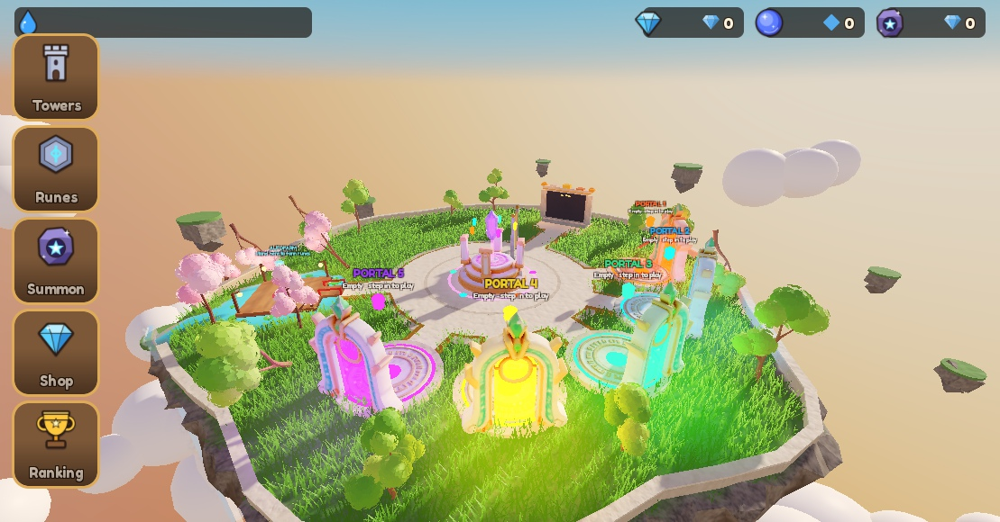
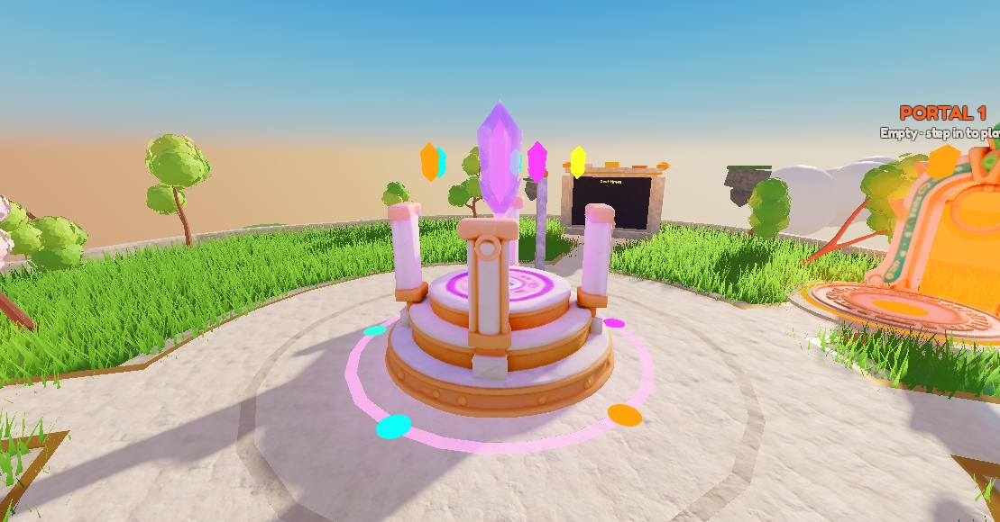
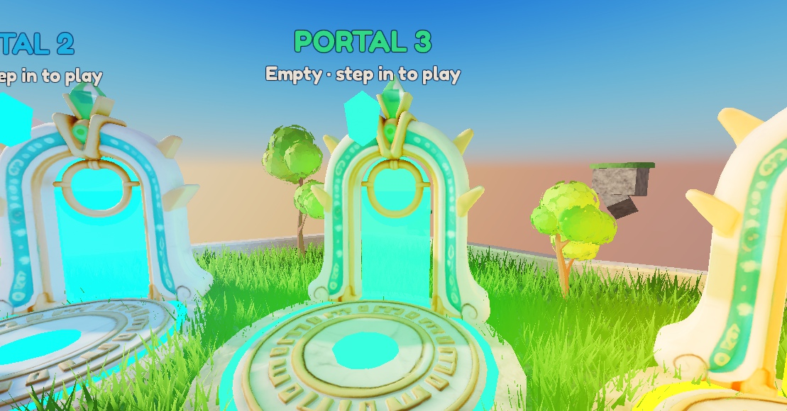
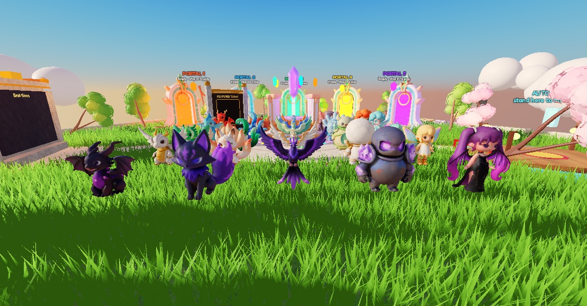
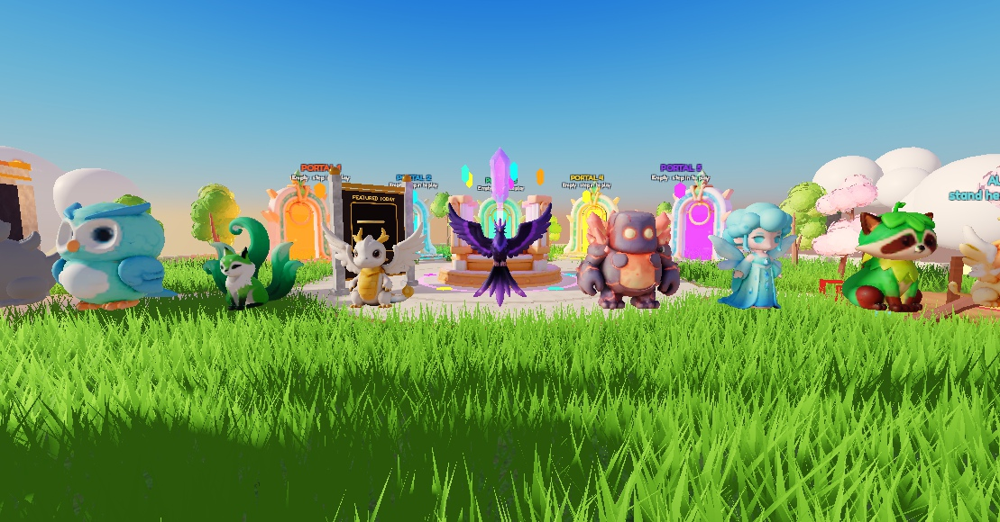

# Roblox TD: Espíritos Elementais

Tower defense para Roblox em que as torres são espíritos elementais invocados por gacha, com progressão permanente inspirada em Summoners War (nível, estrelas, despertar, skills e runas).



| | |
|---|---|
|  |  |
|  |  |

## O que tem aqui

- **[docs/design.md](docs/design.md):** game design completo do MVP. Duas camadas (meta permanente × decisões da run), fórmula de dano, 25 torres (5 famílias × 5 elementos), 10 andares de dificuldade, coop de 2 a 4 jogadores e economia.
- **tools/:** scripts Python que geram arte procedural para o jogo: ícones, retratos, arte da loja e texturas de VFX de invocação (`tools/out/summon_fx`).
- **screenshots/:** capturas do protótipo no Studio.

```
dano = (base × mult_nível_estrela × (1 + ATK%_runas) + ATK_flat_runas)
       × mult_tier_run × mult_elemento × crit × (1 − armadura_efetiva)
```

O código Luau do jogo fica no place do Studio. Veja [roblox-keycap-tycoon](https://github.com/giovaniohira/roblox-keycap-tycoon) para o fluxo com Rojo.
